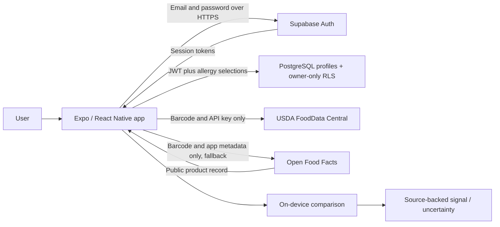

# Security architecture and boundaries

## Data flow

## Data inventory

| Data | Location | Retention |
|---|---|---|
| Email and password authentication | Supabase Auth | Account lifecycle; vendor configuration applies |
| Allergy IDs, consent version, timestamps, user ID | PostgreSQL profiles | Until profile/account deletion; backup retention separately governed |
| Native access/refresh session | Expo SecureStore | Session lifecycle; OS and SDK behavior applies |
| Browser session tokens | JavaScript memory | Current page/session; not localStorage |
| Demo allergy selections | Memory | Until exit/reload |
| Product lookup results and recent scans | Memory, max 30 history entries | Until session exit/reload or clear history |
| Camera frames | Native scanning view | Not uploaded or saved by application |
| Product-provider request metadata | External provider | Governed by provider; barcode/IP/normal HTTP metadata visible |

## Enforced in source and migration

1. Profiles require authentication and matching `auth.uid() = id` for reads and writes. RLS is enabled and forced. Anonymous privileges revoked.
2. Supported values constrained in PostgreSQL; no arbitrary strings accepted as allergies. Column grants protect timestamps from normal clients. Update permits the ID column for PostgREST upsert, but RLS forbids changing it to another identity.
3. Deletion RPC accepts no user ID; security-definer function uses a fixed empty search path, qualified names and session identity. Public and anonymous execution revoked.
4. Allergy matching is local. External product requests contain no email, password or selected allergies.
5. Native token adapter uses SecureStore; web adapter intentionally uses memory. Native refresh starts/stops with app foreground state. No application logging of credentials added.
6. Incoming product data is treated as data, rendered as text and normalized before matching. Barcode validation limits provider path input to numeric GTIN formats with a valid check digit.
7. Lookup timeout, scan lock and request spacing reduce accidental duplicate requests. They are usability controls, **not** a server-side abuse-defense boundary.
8. Failed profile writes retain previous saved selections. Missing profiles/zero selections cannot perform checks. Async lookup results are discarded after identity generation changes.

## Required provider and operational configuration

- HTTPS production endpoints, confirmed email, server-side password policy, approved redirects and reliable SMTP.
- Project-admin MFA, least-privilege project membership, secret handling and periodic access review.
- Auth abuse protection/CAPTCHA/rate limits and account-recovery flow before public signup.
- Review Supabase hosting/encryption/backups for the chosen plan and region; do not describe an unconfigured demo as having verified encrypted backups or disaster recovery.
- Restore testing, documented retention, deletion requests, logging redaction and incident response.
- Provider usage registration/contact information and API version review before distribution. Demo uses read-only v2 compatibility endpoint tested here; provider documentation recommends v3 for new integrations. Migrate adapter with contract tests before production reliance.
- Browser requests use app-identification query values to avoid unsupported custom-header CORS preflight. Native requests use a development User-Agent. Set an approved contact identifier and follow provider identification policy before launch; a small server adapter may be needed if browser identification requirements change.

## Threats and limitations

| Threat | Current control | Remaining work |
|---|---|---|
| Cross-account data access | RLS and grants; local PG tests | Verify hosted API and dashboard state |
| Account takeover | Supabase Auth + native token protection | Recovery, abuse controls, optional end-user MFA, session-policy review |
| False reassurance | Uncertainty states, provenance, explicit caveats | Expert-reviewed matching corpus and richer taxonomy |
| Malicious/stale product data | Plain-text rendering, schema normalization | Provider quality signals, review process, freshness policy |
| Excess provider traffic | Single-flight scan + request interval | Server-enforced quotas and resilient provider strategy at scale |
| Device compromise/XSS | No browser persistent tokens, secure native store | Hardening audit; in-memory tokens are still accessible to malicious script |
| Data loss/provider outage | Graceful lookup errors, deterministic demo samples | Backups, restore test, provider failover, operational alerts |

This demo has not been penetration tested, clinically validated, or certified for HIPAA or other regulatory obligations. Applicable requirements depend on deployment, business model and data use; obtain qualified review before handling sensitive real-user data at scale.

## Dependency note

Initial Expo dependency tree inherited a moderate `uuid` advisory through `xcode`. A scoped override to `uuid ^11.1.1` removes that advisory; `xcode`'s v4 ID generation was smoke-tested for compatibility. Keep this override under review during Expo upgrades. Native build validation remains pending. `npm audit` currently reports no known vulnerabilities; that is not proof of total application security.

References: [Supabase RLS](https://supabase.com/docs/guides/database/postgres/row-level-security), [Supabase data security](https://supabase.com/docs/guides/database/secure-data), [Expo SecureStore](https://docs.expo.dev/versions/latest/sdk/securestore/), [Open Food Facts API](https://openfoodfacts.github.io/openfoodfacts-server/api/).
